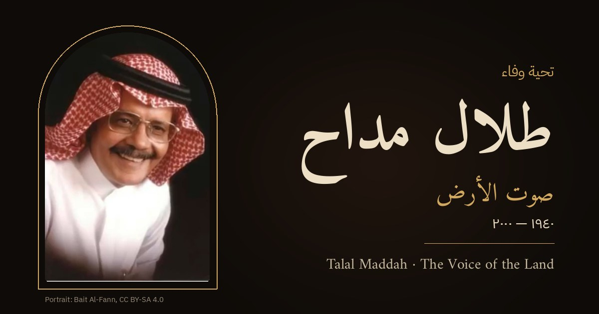

# طلال مداح — صوت الأرض

**[طلال-مداح.com](https://xn----ymcbyi9b9ebk.com)**

تحية وفاء لطلال مداح (١٩٤٠–٢٠٠٠)، صوت الأرض. الموقع رحلة في حياته من مولده في مكة حتى رحيله على مسرح المفتاحة في أبها، مرحلة بعد مرحلة، ولكل مرحلة أغنيتها من قناته الرسمية.

## ماذا يقدّم الموقع

- **رحلة في حياته:** إحدى عشرة مرحلة من ١٩٤٠ إلى ٢٠٠٠: طفولته، العود الذي خبّأه، أول أغنية في إذاعة جدة، «وطني الحبيب»، اكتشافه عبادي الجوهر وابتسام لطفي، رباعيته مع بدر بن عبدالمحسن ومحمد العبدالله الفيصل وسراج عمر، «مقادير» في القاهرة، وصولًا إلى الأغنية الأخيرة «الله يرد خطاك». تتنقّل بين المراحل بالأسهم أو التمرير أو السحب، أو تتركها تمضي وحدها بالتشغيل التلقائي.
- **أغنية لكل مرحلة:** تبدأ الأغنية مع كل مرحلة وتتلاشى عند الانتقال إلى غيرها، والعود المرسوم تهتز أوتاره وتتصاعد منه النغمات مع الموسيقى.
- **الأغاني والألبومات:**
  - أغاني الرحلة مع الشاعر والملحن، وروابط يوتيوب وساوندكلاود والكلمات.
  - ٨٥ ألبومًا رسميًا مرتبة حسب العقد.
  - ٣٠ حفلة وجلسة من القناة الرسمية تضم ٢٢٥ أغنية، كل أغنية برابط تسجيلها.
- **معرض الصور:** صور من الحفلات والتلفزيون وأغلفة الألبومات.
- **اعزف على العود:** عود يُعزف بالأصابع أو بلوحة المفاتيح على خمسة مقامات (راست، بياتي، حجاز، صبا، كرد) بأرباع الأصوات الحقيقية. تنقر الوتر، وتضغط مطوّلًا للرَّش، وتنزلق بين النغمات. ويمكنك أن تسجّل عزفك وتشارك رابطه، أو تتعلّم جملًا تقليدية قصيرة تتبع فيها الضوء.
- **ذكرى الميلاد والرحيل:** في ٥ أغسطس و١١ أغسطس تتغيّر الصفحة الأولى إلى كلمة في ذكراه مع أغنية مناسبة.
- **بالعربية أولًا:** يفتح الموقع بالعربية دائمًا، والإنجليزية بضغطة زر. ويعمل على الجوال والحاسوب.

## المصادر

- **السيرة والتواريخ:** ويكيبيديا العربية والإنجليزية، وصحف عكاظ والوطن والراي والمدينة وصدى البلد وعنب بلدي وسكاي نيوز عربية والجزيرة. التواريخ الهجرية محوّلة إلى سنوات ميلادية تقريبية.
- **الشعراء والملحنون:** الصحافة وأرشيف موقع فنانين. وما لم نتحقق منه مكتوب في الموقع صراحةً.
- **قائمة الألبومات:** ويكيبيديا العربية والإنجليزية. لا تذكر المصادر إلا عقد الإصدار للألبومات قبل ٢٠٠١.
- **الحفلات والجلسات:** قوائم التشغيل في قناة طلال مداح الرسمية على يوتيوب.

إن وجدت خطأ في معلومة أو تاريخ، فافتح بلاغًا في [Issues](../../issues) مع المصدر، ونصحّحه.

## الحقوق والشكر

- **الأغاني والفيديو:** من [قناة طلال مداح الرسمية](https://www.youtube.com/@6laltv-y2n) و[صفحتها على ساوندكلاود](https://soundcloud.com/6lalchannel/). يعرضها الموقع عبر مشغّل يوتيوب، ولا يستضيف أي تسجيل.
- **كلمات الأغاني:** لا ننشر نصوصها احترامًا لحقوق الشعراء وورثتهم، ونحيل إليها في موقعي [فنانين](https://fnanen.com) و[كلمات](https://kalemat.app).
- **الصور:**
  - الصورة الشخصية: بيت الفن، برخصة [CC BY-SA 4.0](https://creativecommons.org/licenses/by-sa/4.0/)، عبر ويكيميديا كومنز. وبطاقة المشاركة مأخوذة منها وتخضع للرخصة نفسها.
  - صورة صحيفة الجزيرة (١٩٨٣): ملكية عامة.
  - بقية الصور: صور مصغّرة لفيديوهات القناة الرسمية.
- **العود المرسوم:** رسمناه على هيئة عوديه المعروفين: العود الداكن ذو الوردات الذهبية، والعود العسلي ذو الوردة المخطوطة الذي عزف عليه في أبها عام ١٩٩٩. أما الكتابة في الوردة فتصميم مستوحى منها، وليست نقلًا للنقش الأصلي.
- **الخطوط:** أميري، وCormorant Garamond، وIBM Plex Sans Arabic، وكلها برخصة SIL Open Font License.

## ملاحظة

هذا موقع غير رسمي، صنعه محبّون تحيةً لفنّه وذكراه، ولا صلة له بعائلته أو بشركات الإنتاج. رحمه الله.

---

للمطوّرين: طريقة التشغيل وبنية الملفات والفحص الآلي في [docs/DEVELOPMENT.md](docs/DEVELOPMENT.md).

